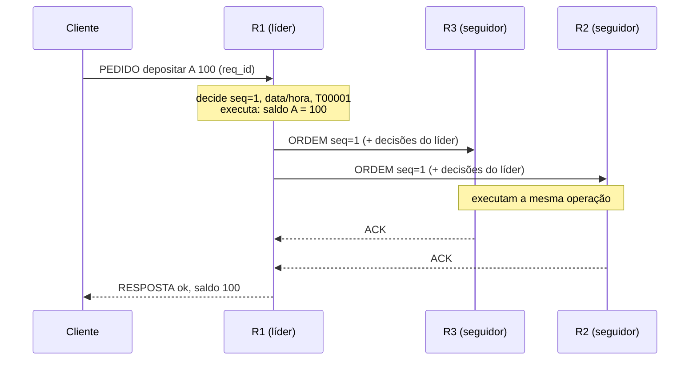
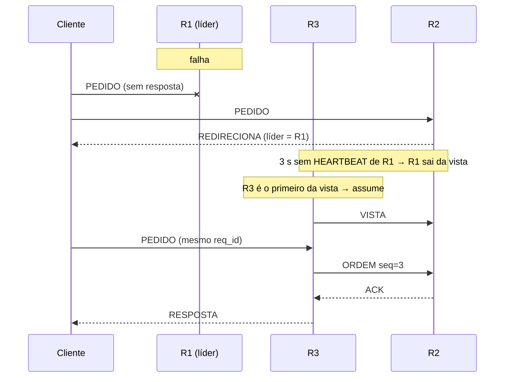
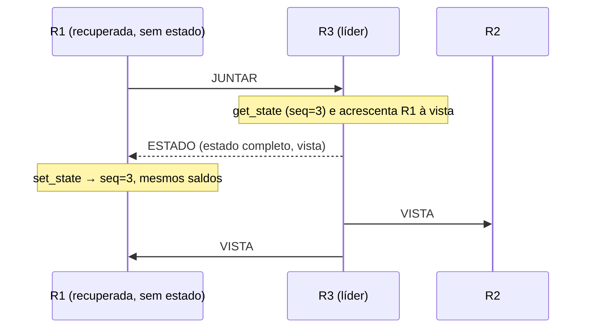

# Replicação Semi-ativa - Banco Replicado

**Trabalho Prático - Sistemas Distribuídos — UFSC Araranguá**
**Grupo 12:** Balduino, Filipe

---

## 1. Proposta do trabalho

Implementação de um **serviço bancário tolerante a faltas** com a técnica de **replicação semi-ativa**. Há três
réplicas (R1, R2, R3) do mesmo servidor, e o serviço continua disponível, sem perder operações, quando uma
delas falha.

Definição usada (Aula 10 — Tolerância a Faltas):

- **Todas as réplicas são ativas** e executam cada operação, mas **só o líder recebe e responde** às
  invocações dos clientes.
- As outras réplicas (os **seguidores**) têm a função de **substituir o líder** caso ele falhe.
- O **determinismo de réplica é garantido pelo líder**.
- Mecanismos necessários: **difusão FIFO**, **detecção de falhas** (timeouts e keepalives), **gerenciamento de
  membros** (*membership*) e **transferência de estado** (`get_state` e `set_state`).

O serviço é uma conta bancária, como no exemplo dos slides: **depositar**, **sacar** (recusado se o saldo for
insuficiente), **saldo** e **extrato**.

---

## 2. Estrutura dos arquivos

| Arquivo | Função |
|---|---|
| `replica.py` | Réplica: servidor TCP, papel de líder ou seguidor, difusão FIFO, heartbeat, vista, transferência de estado |
| `cliente.py` | Cliente de terminal: operações bancárias (fala só com o líder) e comandos de teste |
| `painel.py` | Painel web de simulação: réplicas, mensagens em tempo real, operações e falhas |
| `config.json` | Números das réplicas, endereços/portas e tempos limite |
| `iniciar_replicas.sh` / `parar_replicas.sh` | Sobe/encerra as 3 réplicas em segundo plano (Linux/macOS) |
| `iniciar_replicas.bat` | Abre uma janela para cada réplica (Windows) |

---

## 3. Identificação das réplicas

Cada réplica tem um **número** (1, 2, 3) definido no `config.json`, com o seu endereço:

```json
"replicas": {
  "1": {"host": "127.0.0.1", "porta": 6001},
  "2": {"host": "127.0.0.1", "porta": 6002},
  "3": {"host": "127.0.0.1", "porta": 6003}
}
```

O número é passado ao executar (`python replica.py --id 2`) e lido em `replica.py`:

```python
self.id = meu_id
# Números das réplicas: chaves do config.json
self.replicas = {int(r): (d["host"], d["porta"])
                 for r, d in config["replicas"].items()}
```

O papel de cada réplica é dado pela **vista**, a lista ordenada das réplicas ativas do grupo. O **líder é sempre o
primeiro da vista**; se ele falhar, o seguinte da lista assume.

```python
@property
def lider(self):
    return self.vista[0] if self.vista else None
```

---

## 4. Requisitos funcionais

### 4.1 Servidor (cada réplica)

**Como líder:**

- recebe os pedidos dos clientes (os seguidores redirecionam o cliente ao líder);
- decide a **ordem** de cada operação (número de sequência) e os **valores não determinísticos** (data/hora e
  identificador da transação);
- executa a operação, **difunde a ORDEM** aos seguidores em ordem FIFO, espera os ACKs e só então responde ao cliente;
- envia **HEARTBEAT** (keepalive) aos seguidores a cada 1 s e exclui da vista quem não responde;
- envia o estado (`get_state`) a quem entra no grupo ou está atrasado.

**Como seguidor:**

- executa as ordens do líder na sequência recebida e responde **ACK** ao líder, nunca ao cliente;
- considera o líder falho se ficar 3 s sem notícias dele; se for o próximo da vista, assume a liderança.

**Ao arrancar ou voltar de uma falha**, a réplica pede para entrar no grupo (**JUNTAR**) e recebe o estado completo
(`set_state`).

### 4.2 Cliente

- Envia **PEDIDO** (depositar, sacar, saldo, extrato) com um identificador único `req_id`.
- Se falar com um seguidor, recebe **REDIRECIONA** com o número do líder e segue para ele.
- Se o líder não responder, tenta as outras réplicas até um novo líder assumir, com o **mesmo** `req_id`. Assim um
  pedido reenviado nunca é executado duas vezes.

### 4.3 Mensagens

Todas as mensagens são objetos **JSON numa linha**, com os campos `tipo` e `origem`.

| Tipo | De → Para | Significado | Resposta |
|---|---|---|---|
| `PEDIDO` | cliente → líder | Operação bancária (`op`, `conta`, `valor`, `req_id`) | `RESPOSTA`, `REDIRECIONA` ou `ERRO` |
| `ORDEM` | líder → seguidores | Operação já ordenada (`seq`) com as decisões do líder | `ACK` ou `FALTA` |
| `ACK` | seguidor → líder | Ordem executada | — |
| `FALTA` | seguidor → líder | “Recebi uma ordem fora de sequência, falta-me alguma” | — (o líder envia `SET_STATE`) |
| `HEARTBEAT` | líder → seguidores | Keepalive com a vista e o último `seq` confirmado | `ACK` |
| `VISTA` | líder → membros | Nova composição do grupo (*membership*) | `ACK` |
| `JUNTAR` | réplica → líder | Pedido para entrar no grupo | `ESTADO` (get_state) |
| `PEDIR_ESTADO` / `SET_STATE` | réplica ↔ líder | Transferência de estado | `ESTADO` / `ACK` |
| `STATUS`, `EVENTOS` | cliente/painel → réplica | Consulta do estado e dos eventos | `STATUS`, `EVENTOS` |
| `FALHAR`, `RECUPERAR` | cliente/painel → réplica | Simula a queda (perdendo a memória) e a volta | `ACK` |

Exemplos:

```json
{"tipo": "PEDIDO", "origem": "cliente-3fa1c2", "req_id": "3fa1c2-1", "op": "depositar", "conta": "A", "valor": 100}
{"tipo": "ORDEM", "origem": 1, "num_vista": 3, "vista": [1, 3, 2],
 "ordem": {"seq": 1, "req_id": "3fa1c2-1", "op": "depositar", "conta": "A", "valor": 100.0,
           "data_hora": "14/11/2026 21:57:19.391", "transacao": "T00001-R1"}}
{"tipo": "RESPOSTA", "origem": 1, "op": "depositar", "conta": "A", "ok": true, "saldo": 100.0,
 "transacao": "T00001-R1", "data_hora": "14/11/2026 21:57:19.391", "seq": 1}
```

---

## 5. Comunicação entre cliente e servidor

- Protocolo **TCP**, modelo **requisição–resposta**: cada mensagem abre uma conexão, envia uma linha JSON e lê uma
  linha JSON de resposta.
- **Detecção de falhas:** se o destino não responder dentro de `timeout_conexao` (1 s), considera-se que falhou. Uma
  réplica com falha simulada aceita a conexão mas não responde, com o mesmo efeito de um processo morto.

### 5.1 Envio de mensagens (`replica.py`)

```python
def enviar_mensagem(host, porta, mensagem, timeout):
    try:
        with socket.create_connection((host, porta), timeout=timeout) as s:
            s.settimeout(timeout)
            s.sendall((json.dumps(mensagem) + "\n").encode("utf-8"))
            linha = s.makefile("r", encoding="utf-8").readline()
            return json.loads(linha) if linha else None
    except (OSError, ValueError):
        return None
```

### 5.2 Recepção de mensagens (`replica.py`)

```python
class TratadorConexao(socketserver.StreamRequestHandler):
    def handle(self):
        try:
            linha = self.rfile.readline().decode("utf-8")
            if not linha:
                return
            mensagem = json.loads(linha)
        except (OSError, ValueError):
            return
        resposta = self.server.replica.tratar_mensagem(mensagem)
        if resposta is not None:          # None = réplica "caída": não responde
            self.wfile.write((json.dumps(resposta) + "\n").encode("utf-8"))
```

O servidor é um `ThreadingTCPServer` (uma *thread* por conexão). Só o líder atende o cliente:

```python
if tipo == "PEDIDO":
    if self.sou_lider():
        return self.processar_pedido(msg)
    # Só o líder recebe invocações de clientes
    return {"tipo": "REDIRECIONA", "origem": self.id, "lider": self.lider}
```

### 5.3 Diagrama de sequência — operação normal



### 5.4 Diagrama de sequência — falha do líder



### 5.5 Diagrama de sequência — réplica volta ao grupo



---

## 6. O serviço e a replicação no servidor

### 6.1 Determinismo garantido pelo líder

A operação bancária é **determinística**: com as mesmas ordens, na mesma sequência, todas as réplicas chegam ao mesmo
estado. Tudo o que poderia variar entre réplicas (**ordem**, **data/hora**, **número da transação**) é decidido só
pelo líder e enviado dentro da ORDEM:

```python
# O LÍDER decide a ordem e os valores não determinísticos
ordem = {"seq": self.estado["seq"] + 1, "req_id": req_id, "op": op,
         "conta": conta, "valor": valor,
         "data_hora": datetime.now().strftime("%d/%m/%Y %H:%M:%S.%f")[:-3],
         "transacao": f"T{self.estado['seq'] + 1:05d}-R{self.id}"}
res = self.aplicar(ordem)
seguidores = [r for r in self.vista if r != self.id]
self.difundir_ordem(ordem, seguidores)
```

Se cada réplica lesse o seu próprio relógio, os extratos seriam diferentes. Com a data/hora decidida pelo líder,
são idênticos em todas.

### 6.2 Difusão FIFO

O líder processa um pedido de cada vez (`trava_ordem`), por isso as ordens saem na sequência 1, 2, 3, … Cada seguidor
verifica a sequência antes de executar:

```python
with self.trava:
    atual = self.estado["seq"]
    if ordem["seq"] <= atual:                 # repetida: já aplicada
        return {"tipo": "ACK", "origem": self.id, "seq": atual}
    if ordem["seq"] > atual + 1:              # falta alguma: pede estado
        return {"tipo": "FALTA", "origem": self.id, "seq": atual}
    res = self.aplicar(ordem)
return {"tipo": "ACK", "origem": self.id, "seq": ordem["seq"]}
```

### 6.3 Detecção de falhas e gerenciamento de membros

- O **líder** envia HEARTBEAT a cada `intervalo_heartbeat` (1 s). Um seguidor que não responde a um HEARTBEAT ou a uma
  ORDEM é **excluído da vista**, e o líder difunde a nova VISTA.
- Um **seguidor** que fica `suspeita_lider` (3 s) sem HEARTBEAT considera o líder falho e retira-o da vista. Se passar
  a ser o primeiro da vista, **assume a liderança**: consulta as outras réplicas, adota o estado mais adiantado (caso
  alguém tenha recebido uma ORDEM que ele não recebeu) e anuncia a nova vista.

```python
if time.time() - self.ultimo_heartbeat > self.t_suspeita:
    antigo = self.lider
    with self.trava:
        self.vista = [r for r in self.vista if r != antigo]
    self.ultimo_heartbeat = time.time()
    if self.lider == self.id:
        self.assumir_lideranca()
```

### 6.4 Transferência de estado (`get_state` / `set_state`)

O estado replicado é `seq`, `contas`, `extrato` e `executados`; este último guarda os resultados por `req_id` para
evitar repetições. Uma réplica que entra ou volta envia **JUNTAR** ao líder. O líder acrescenta-a à vista e devolve
uma cópia do estado, sem nenhuma ORDEM a meio:

```python
with self.trava_ordem:                        # estado consistente
    with self.trava:
        if origem not in self.vista:
            self.vista.append(origem)
            self.num_vista += 1
        estado = self.get_state()
```

### 6.5 Pedidos repetidos

Se o líder falhar depois de executar mas antes de responder, o cliente reenvia o mesmo `req_id` ao novo líder. Este já
tem a operação no estado (recebeu-a por ORDEM), por isso devolve o resultado guardado em vez de executar de novo:

```python
anterior = self.estado["executados"].get(req_id)
if anterior is not None:
    return {"tipo": "RESPOSTA", "origem": self.id, "op": op, "conta": conta,
            "repetido": True, **anterior}
```

---

## 7. Instalação e execução

### 7.1 Requisitos

- **Python 3.8 ou superior**. Não há bibliotecas externas a instalar.
- Portas TCP **6001–6003** (réplicas) e **8080** (painel) livres. As portas das réplicas mudam-se no
  `config.json`; a do painel, com a opção `--porta`.

### 7.2 Configuração (`config.json`)

| Parâmetro | Padrão | Significado |
|---|---|---|
| `timeout_conexao` | 1,0 s | Tempo sem resposta para considerar uma réplica falha |
| `intervalo_heartbeat` | 1,0 s | Intervalo entre keepalives do líder |
| `suspeita_lider` | 3,0 s | Tempo sem notícias do líder até um seguidor o considerar falho |

Para rodar em várias máquinas, troque `127.0.0.1` pelo IP de cada uma. Pode acrescentar réplicas ao `config.json`.

### 7.3 Subir as réplicas

**Um terminal por réplica (recomendado na apresentação):**

```bash
python replica.py --id 1
python replica.py --id 2
python replica.py --id 3
```

A primeira réplica a arrancar cria o grupo e fica líder; as outras pedem para entrar (JUNTAR). Para R1 ser o
líder, inicie-a primeiro. No Windows, `iniciar_replicas.bat` abre as três janelas. No Linux/macOS também se pode usar `./iniciar_replicas.sh`
(logs em `logs/`) e `./parar_replicas.sh`.

### 7.4 Cliente de terminal

```bash
python cliente.py depositar A 100
python cliente.py sacar A 30
python cliente.py saldo A
python cliente.py extrato A
python cliente.py todos          # estado de todas as réplicas (líder, vista, seq, saldos)
python cliente.py falhar 1       # simula a falha da réplica 1 (perde a memória)
python cliente.py recuperar 1    # a réplica 1 volta e recebe o estado do líder
python cliente.py                # modo interativo
```

### 7.5 Painel de simulação (interface gráfica)

Com as réplicas a correr:

```bash
python painel.py                 # abre http://localhost:8080
```

O painel mostra:

- **o cliente, o líder (amarelo, com coroa) e os seguidores**, com setas animadas para cada mensagem: PEDIDO e RESPOSTA
  (roxo), ORDEM (laranja), ACK (verde), VISTA (azul), transferência de estado (ciano), JUNTAR (amarelo) e falha
  detectada (vermelho tracejado);
- **o estado em cada réplica** (seq e saldos), para confirmar que todas as réplicas ativas estão iguais;
- **a linha do tempo** de todas as mensagens;
- **os controlos**: depositar, sacar, saldo e extrato, e os botões Falhar e Recuperar em cada réplica.

### 7.6 Roteiro de demonstração (testado)

Saída real de uma execução (réplicas iniciadas com `./iniciar_replicas.sh`):

```text
$ python cliente.py todos
R1: LÍDER    | vista #3 [1, 2, 3] | seq=0 | contas: -
R2: seguidor | vista #3 [1, 2, 3] | seq=0 | contas: -
R3: seguidor | vista #3 [1, 2, 3] | seq=0 | contas: -

$ python cliente.py depositar A 100
depositar conta A: OK | saldo = 100.00 | transação T00001-R1 em 14/11/2026 21:58:54.037 | respondido pelo líder R1

$ python cliente.py sacar A 1000
sacar conta A: RECUSADO (saldo insuficiente) | saldo = 100.00 | transação T00002-R1 em 14/11/2026 21:58:54.083 | respondido pelo líder R1

$ python cliente.py falhar 1                    # o líder cai
$ python cliente.py depositar A 10              # o cliente espera a troca de líder
  (R1: sem resposta)
  (R2: não sou o líder -> R1)
  (R3: não sou o líder -> R1)
  (R3: não sou o líder -> R2)
  (R2: sem resposta)
  (resposta obtida após 4.2 s)
depositar conta A: OK | saldo = 110.00 | transação T00003-R2 em 14/11/2026 21:58:58.421 | respondido pelo líder R2

$ python cliente.py recuperar 1                 # R1 volta e recebe o estado (set_state)
$ python cliente.py todos
R1: seguidor | vista #5 [2, 3, 1] | seq=3 | contas: A=110.00
R2: LÍDER    | vista #5 [2, 3, 1] | seq=3 | contas: A=110.00
R3: seguidor | vista #5 [2, 3, 1] | seq=3 | contas: A=110.00
```

Cenários testados:

- **Falha do líder:** um seguidor assume, sem perder operações.
- **Falha de um seguidor:** é excluído da vista e o serviço continua.
- **Falha de duas réplicas:** a última continua sozinha.
- **Processo morto (Ctrl+C) e reiniciado:** volta com transferência de estado.
- **Reenvio do mesmo `req_id`:** não é executado duas vezes.

---

## 8. Limitações

- Modelo de falhas por **parada** (*crash*): não tolera réplicas bizantinas nem partições de rede. Numa partição, os
  dois lados poderiam ter um líder.
- A detecção de falhas usa tempo limite e por isso assume um sistema **parcialmente síncrono**.
- A troca de líder leva cerca de `suspeita_lider` + 1 s. Durante esse intervalo o cliente espera e reenvia.
- O estado fica em memória: se **todas** as réplicas caírem ao mesmo tempo, o estado perde-se.

## 9. Referências

- LAU, J. *Aula 10 – Tolerância a Faltas (Partes 2 e 3): técnicas de replicação passiva, ativa e semi-ativa*.
  Sistemas Distribuídos, UFSC.
- POWELL, D. (ed.). *Delta-4: A Generic Architecture for Dependable Distributed Computing*. Springer, 1991.
- TANENBAUM, A. S.; VAN STEEN, M. *Sistemas Distribuídos: princípios e paradigmas*. 2. ed. Pearson, 2007.
